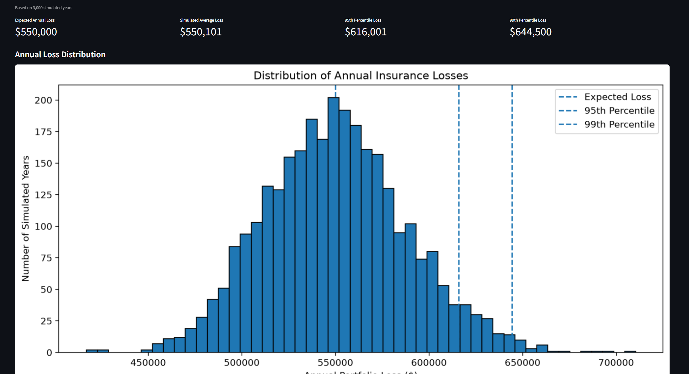

# RiskLab — Insurance Loss Modeling & Pricing Simulator

RiskLab is a Python-based insurance risk modeling and pricing simulator that uses Monte Carlo methods to evaluate portfolio losses, analyze claim frequency and severity, and estimate insurance premiums.

The project models insurance claim frequency using a Poisson distribution and claim severity using a Lognormal distribution. It also includes an interactive Streamlit dashboard for exploring model assumptions and comparing portfolio risk.

## Features

- **Monte Carlo Simulation:** Simulates annual insurance portfolio losses across thousands of hypothetical years.
- **Claim Frequency Modeling:** Uses a Poisson distribution to model the number of claims per policy.
- **Claim Severity Modeling:** Uses a Lognormal distribution to model individual claim costs.
- **Risk Analysis:** Calculates expected annual losses, standard deviation, and 95th and 99th percentile loss estimates.
- **Model Validation:** Compares simulated results against theoretical expectations.
- **Insurance Pricing:** Calculates pure premiums and gross premiums using a configurable risk loading.
- **Sensitivity Analysis:** Evaluates how changes in claim frequency, severity, and risk loading affect premiums.
- **Portfolio Comparison:** Compares portfolios with different risk assumptions.
- **Interactive Dashboard:** Uses Streamlit to visualize simulation results and adjust model parameters.
- **Automated Testing:** Uses pytest to verify simulation, pricing, and parameter validation.

## Dashboard Preview

## Mathematical Model

### 1. Claim Frequency

The number of claims for each policy is modeled using a Poisson distribution:

N ~ Poisson(λ)

Where:
- N = Number of claims per policy-year
- λ = Expected number of claims per policy-year

### 2. Claim Severity

Individual claim costs are modeled using a Lognormal distribution:

X ~ Lognormal(μ, σ)

The parameters are defined as:

μ = ln(m) - σ² / 2

Where:
- X = Individual claim severity
- m = Expected claim severity
- σ = Lognormal standard deviation parameter

This parameterization ensures that the expected claim severity is equal to m.

### 3. Aggregate Portfolio Loss

Annual portfolio losses are calculated by summing all individual claim costs:

L = Σᵢ Σⱼ Xᵢⱼ

Where:
- L = Total annual portfolio loss
- i = Policy
- j = Individual claim for that policy

The theoretical expected annual portfolio loss is:

E[L] = nλm

The theoretical variance is:

Var(L) = nλm²e^(σ²)

Where:
- n = Number of policies
- λ = Claim frequency
- m = Average claim severity
- σ = Lognormal severity parameter

These theoretical values provide benchmarks for validating the Monte Carlo simulation.

### 4. Insurance Pricing

Pure premium represents the expected claim cost per policy:

Pure Premium = λm

Gross premium includes an additional risk loading:

Gross Premium = Pure Premium × (1 + Risk Loading)

## Default Model Assumptions

| Parameter | Default Value |
|---|---:|
| Number of Policies | 1,000 |
| Claim Frequency | 0.3 |
| Average Claim Severity | $1,000 |
| Severity Volatility (σ) | 1.0 |
| Risk Loading | 20% |
| Monte Carlo Simulations | 10,000 |

These assumptions are configurable.

## Technology Stack

- **Python** — Core programming language
- **NumPy** — Probability distributions and vectorized numerical calculations
- **Matplotlib** — Data visualization
- **Streamlit** — Interactive web dashboard
- **pytest** — Automated testing
- **Git / GitHub** — Version control

## Project Structure

RiskLab/
├── app.py
├── main.py
├── parameters.py
├── simulation.py
├── visualization.py
├── test_simulation.py
├── requirements.txt
├── .gitignore
└── README.md

## Installation

1. Clone the repository:

   git clone YOUR_REPOSITORY_URL

2. Navigate to the project directory:

   cd RiskLab

3. Install dependencies:

   pip install -r requirements.txt

## Usage

### Interactive Dashboard

Launch the Streamlit dashboard:

   streamlit run app.py

The dashboard allows users to:
- Adjust insurance model assumptions.
- Run Monte Carlo simulations.
- Analyze annual loss distributions.
- Examine frequency and severity statistics.
- Compare portfolio risk.
- Explore insurance premium calculations.

### Command-Line Simulation

Run the original simulation workflow:

   python main.py

### Automated Tests

Run the test suite:

   pytest -v

## Future Improvements

Potential extensions include:
- Modeling dependence between insurance claims.
- Adding reinsurance and deductible structures.
- Incorporating inflation and changing claim trends.
- Exploring alternative claim severity distributions.
- Adding more advanced risk measures such as Conditional Value at Risk (CVaR).

Developed as an independent actuarial and quantitative modeling project.

